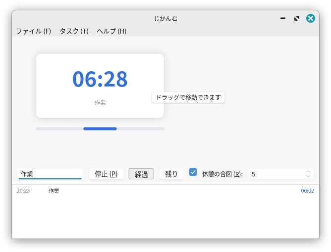

# ergon-slint-controls
<p align="center">
  <br>
</p>

## はじめに：私たちの「画面の土地」を取り戻すために

あなたは、最近のパソコンのUIが「やけにデカい」と感じたことはありませんか？

Windows 8 以降、まるでタブレットのようにタッチパネルを前提としたUIが増えたことにより、画面の貴重な領域が占領され、マウスの移動量も無駄に増えてしまいました。複数ウィンドウを自由に行き来できるパソコンならではの利点が打ち消され、「私の大切な土地を占領するな」と憤りを感じたことがあるのは、きっとあなただけではありません。

一方で、情報密度が高くクラシックなUIを持つクロスプラットフォームアプリを作ろうとすると、別の壁にぶつかります。Web技術（Electronなど）を使えばメモリを大食いする重いソフトになってしまい、C++（Qtなど）を使えばWindowsで大量の依存ファイル群を同梱する羽目になります。

そこでまず注目したのが、Rustならではの軽量かつ高速なUIフレームワークである **Slint** です。スマートフォンや車載ディスプレイもターゲットとしているため、Windows 7 時代と比べれば確かにデカいですが、Slint のコントロールをフォークして余白さえ調整すれば、軽量かつデカくないGUIが構築できるのではないか、と考えたのが、このプロジェクトの始まりです。

しかし、ergon-slint-controls に含まれているのはコントロールだけではありません。私がSlintでデスクトップアプリを開発していたときの違和感への修正が含まれています。というのは、Slintは、スマートフォンのように、設定画面やメッセージボックスといったダイアログが「1つのウィンドウの中に収まるオーバーレイ」として表示することを想定していて、小ウィンドウが簡単に創れません。
Linuxなどのデスクトップ環境で、モーダルダイアログを表示している時にドラッグして裏のウィンドウの情報を確認したくても、自分の管理下にあるウィンドウマネージャーのルールに背きダイアログが画面を塞いでしまい、「スマホじゃねーよ、複数ウィンドウを同時に表示しながら行き来できるのがパソコンだろ」ともどかしく思ったことはないでしょうか？

**「モダンな開発体験を残しつつ、Windows 7時代のような適度な余白に縮めたUIが欲しい」**
**「OSネイティブのウィンドウやダイアログの挙動を、簡単に呼び出したい」**

モダンとクラシックの長所を融合させ、そんな理想のGUIを構築するために生まれたのが、この **`ergon-slint-controls`** です。

## 概要

Slint 向けの汎用部品集と OS 統合ユーティリティ。デスクトップ GUI アプリに不可欠な
「メニューバー + モーダルダイアログ + ネイティブメッセージボックスを Windows でおなじみの `&` アクセスキーで統一したコードで記述できる」（ライブラリがLinuxはアンダーバーに勝手に読み替えてコンパイルします）状態を 1 つのライブラリで揃え、更にはマウスポインタをカスタム画像にするような、OSに依存する面倒な処理までライブラリに含めています。（Rustなら使わない関数はコンパイル時に排除されるので、ちょっと手が届きにくいOS依存な処理群まで含めています）

配置や WM 制御は OS / WM の責任とし、このライブラリは「部品の描画」「記法の解釈」「OS ネイティブ機能の呼び出し」までを担い、それをどう使うかはすべて呼び出し側に任せます。

| カテゴリ | 内容 | 参照方法 |
|---|---|---|
| Slint 部品 | メニューバー / 小ボタン / トグルボタン / チェックボックス / スピンボックス / テキストボックス / 複数行テキストボックス / スクロールビュー / ラベル / ツールチップレイヤ | `.slint` 内で `import { ... } from "@ergon_slint_controls"` |
| Rust ユーティリティ | `menu` (`&` 記法パース) / `dialogs` (ネイティブ ダイアログ) / `platform` (タイトルバー・アイコン・修飾キー) / `cursor` (カーソル制御) / `gtk` (Linux) | `use ergon_slint_controls::...` |
| `modal_dialog` | モーダル ダイアログ制御 (feature `modal-dialog` / 既定オフ) | `use ergon_slint_controls::modal_dialog::...` |

**完全に動くサンプルが `examples/timekeeper.rs`** （作業時間トラッカー「じかん君」）にあります。
全機能を実際に配線したコードはここにあるため、このREADMEではAPIの解説とライブラリに触る要点に絞っています。
サンプルは `modal-dialog` 機能を使用しているため、以下のように実行します。

```sh
cargo run --example timekeeper --features modal-dialog
```

## 導入方法

### Cargo.toml

```toml
[dependencies]
# slint 本体。ergon-slint-controls と同じ feature セットにします。
slint = { version = "1.17", features = ["std", "backend-winit", "renderer-femtovg", "compat-1-2", "unstable-winit-030"] }

# 本ライブラリ。モーダル制御も使うなら feature を有効にします。
# 表示方式 (子ウィンドウ / オーバーレイ) はアプリのソースコード内の定数で決めるため、ここでは指定しません。
ergon-slint-controls = { git = "https://github.com/akenejie/ergon-slint-controls", tag = "v0.5.0", features = ["modal-dialog"] }

[build-dependencies]
# experimental-module-builds は必須 (@import 解決の仕組み)。
slint-build = { version = "1.17", features = ["experimental-module-builds"] }

# modal-dialog feature を有効にする場合、生 winit のパッチフォークが必要です。
[patch.crates-io]
winit = { git = "https://github.com/akenejie/slint-modal-winit", tag = "v0.30.13-modal.10" }
```

> **注意:**
> * Linux では `libgtk-3-dev` + `pkg-config` が必要です (同一プロセス GTK ダイアログ用)。
> * Windows では、アプリの実行ファイルに **Common-Controls v6 を要求するアプリケーションマニフェストを埋め込む**必要があります。これがないと起動直後に `STATUS_ENTRYPOINT_NOT_FOUND` でクラッシュします（Rustの `embed-manifest` クレート等で対応可能）。
> 
> 

### build.rs

```rust
fn main() {
	let config = slint_build::CompilerConfiguration::new().with_style("fluent-light".into());
	slint_build::compile_with_config("ui/main.slint", config).unwrap();
}
```

`.slint` 内の `@ergon_slint_controls` インポートはライブラリ内部で自動解決されるため、`build.rs` に特別な記述は不要です。

### .slint (マークアップ側の参照)

```slint
import { Label, SmallButton, ModeToggleButton, CosmicCheckBox, SpinBox, TextBox,
		 FluentMenuBarImpl, FluentMenuBarItem, FluentMenuFrame, MenuItemView,
		 MenuAccessKey, AccessKeyHub, AppTooltip, MenuHintPopup, TooltipPopup } from "@ergon_slint_controls";

// グローバルを Rust 側から触るにはルート .slint で再エクスポートします
export { MenuAccessKey, AccessKeyHub }
```

## Slint 部品リファレンス

### `&` アクセスキー記法

タイトル文字列に Win32 標準の記法をそのまま書きます。これが表示（下線）と動作の唯一の情報源となります。

* `&X` : `X` をアクセスキーにする（下線が引かれる）
* `&&` または 末尾の孤立した `&` : リテラルの `&`

### UI部品一覧

| 部品 | 主なプロパティ / コールバック | 備考 |
| --- | --- | --- |
| `Label` | `text` / `access-key-pressed()` | アクセスキーが押されると発火 |
| `SmallButton` | `text`, `icon`, `tooltip-text`, `primary`, `enabled` / `clicked()` | 高さ 22px 級の小ボタン |
| `ModeToggleButton` | 同上 / `checked` / `clicked()` | 群から 1 つ選ぶトグル |
| `CosmicCheckBox` | `checked`, `checked-color` | 見た目だけのチェックボックス。クリック処理は自前実装 |
| `SpinBox` | `value` (in-out), `minimum`, `maximum`, `step-size`, `read-only` / `edited(int)` | 上下ボタン付きの数値入力 |
| `TextBox` | `text` (in-out), `placeholder-text`, `read-only`, `input-type` / `accepted`, `edited` | 1 行テキスト入力。右クリックでコンテキストメニュー対応 |
| `MultiLineTextBox` | `text` (in-out), `wrap`, `content-x/y` / `edited`, `key-pressed` | 複数行テキスト入力 (スクロール付き) |
| `ScrollView` | `content-width/height` (in-out) / `scrolled()` | スクロールビュー (ScrollBar 付き Flickable) |
| `AppTooltip` | `text`, `padding-h`, `padding-v` | 組み込み `Tooltip` 要素の中身として使う |

### メニューバー関連部品

ドロップダウンは標準の `MenuBar` と異なり、**アプリが配置する in-window オーバーレイ**です。

| 部品 | 役割 |
| --- | --- |
| `FluentMenuBarImpl` | メニューバーのベース |
| `FluentMenuBarItem` | バー項目。`description` プロパティは hover 中に `MenuHintHub` へ報告されます |
| `FluentMenuFrame` | ドロップダウン本体。`activated(int)` で選択処理を行います |
| `MenuEntry` | 項目データ (`title`, `shortcut`, `checkable`, `checked`, `is-separator`) |
| `MenuDismissLayer` | メニューの外側クリックで閉じるためのレイヤ |

**メニューバーの構造登録とキー操作 (v0.13.0+)**
アプリは「メニュー内の項目」と「処理」を登録するだけです。Altキーによる開閉や下線管理はライブラリが行います。

```slint
init => {
	MenuKeyControl.menus = [
		{ title: root.file-menu-title, items: root.file-items },
	];
}
```

### ツールチップとポップアップ

アプリのウィンドウのルートの**最後**に以下の透明レイヤを配置することで機能します。

```slint
export component MainWindow inherits Window {
	// ... アプリのコンテンツ ...
	MenuHintPopup { } // メニュー項目の説明を左下に出す
	TooltipPopup { }  // コントロールのツールチップ(tooltip-text)をカーソル追従で出す
}
```

* **MenuHintHub**: `MenuHintPopup` の代わりに、自前のステータスバーにテキスト(`MenuHintHub.text`)を表示することも可能です。
* **TooltipPopup**: 配置の計算はRust側で行われ、画面端ではみ出さないようポインタ基準で四つ角に調整されます（`SLINT_TOOLTIP_DEBUG=1` で配置デバッグが可能）。

### UIフォントの最適化

OSごとの標準フォント（WindowsならYu Gothic UI、LinuxならGTKのUIフォント設定）を自動適用できます。`.slint` 側で動的バインディングを設定し、Rust側から適用関数を呼びます。

```slint
in property <string> ui-font-family: "";
default-font-family: root.ui-font-family;
```

```rust
// Rust側で初期化時に呼ぶだけ
ergon_slint_controls::ui_font::apply_os_default();
```

---

## Rust ユーティリティ API リファレンス

### `menu` — `&` 記法のパースと発火

* `parse_access_key(&str) -> AccessKeyParts` : 文字列からアクセスキーを抽出
* `access_key_char(&str) -> Option<char>` : 比較用の文字を取得
* `pressed_char(&winit::event::KeyEvent) -> Option<char>` : 押されたキーの文字を取得 (Releasedは無視)

### `dialogs` — ネイティブダイアログ

| 関数 | シグネチャ / 役割 |
| --- | --- |
| `show_message_box` | `(title, text, kind: MessageIcon)` : エラー / 情報の表示 (fire-and-forget)。1フレーム遅延して表示 |
| `message_box` | `(title, text, buttons) -> Option<MessageResponse>` : Ok / YesNo などの応答を取得 |
| `message_box_custom` | `(title, text, choices: &[&str], default) -> Option<usize>` : カスタム文字列ボタン |
| `prompt_folder` | `(title, initial: Option<&Path>) -> Option<PathBuf>` : フォルダ選択ダイアログ |

### `platform` — OS 固有の窓周り

* `setup_window(&ui, theme)` : 窓の初期設定。装飾テーマ指定やLinuxのフォーカス盗み取り防止の設定。
* `apply_app_icon(&ui, AppIcon)` : Windows(exeリソース) / Linux・macOS(RGBA画像) のアプリアイコン適用。
* `os_modifier_keys()` : macOSの物理差異を吸収した `(shift, ctrl)` の押下状態取得。

### `cursor` — カーソル制御

* `cache_window(...)` : 対象のwinitウィンドウを登録
* `set_custom_cursor(key, || CursorBitmap) -> bool` : 自前画像(RGBA)からのカーソル設定
* `set_file_cursor(key, &Path) -> bool` : `.cur` ファイルからのカーソル設定 (Windows)


## `modal_dialog` — モーダルダイアログ制御

ダイアログを「子ウィンドウ」として出すか、「インウィンドウのオーバーレイ」として出すか、**ソースコード上の定数1つで切り替えられます**。これにより、PC向けとモバイル/車載向けでUIの振る舞いを簡単に変更できます。

```rust
use ergon_slint_controls::modal_dialog::ModalMode;

// 例: 全OSで子ウィンドウ方式に固定する
const MODAL_MODE: ModalMode = ModalMode::ChildWindow;
```

定数による分岐のため、使われない方式のコードはコンパイル時に削除され、バイナリ肥大化を防ぎます。

### 実装手順の例（子ウィンドウ方式）

```rust
// 1. バックエンドの準備
ergon_slint_controls::modal_dialog::prepare_backend()?;

// 2. スロットの準備
let slot: ergon_slint_controls::modal_dialog::ModalSlot = Default::default();

// 3. ダイアログを開く
// 次のウィンドウ生成を子ダイアログとしてマーク
ergon_slint_controls::modal_dialog::mark_next_window_as_child_dialog();
ergon_slint_controls::modal_dialog::open_child_modal(&slot, &main, Rc::new(ExportDialog(dlg)));

// 4. ダイアログを閉じる
ergon_slint_controls::modal_dialog::close_child_modal(&slot, main.window());
```

### 実装手順の例（オーバーレイ方式）

```rust
// OverlayHost トレイトを実装したラッパーを作成し、開閉を行う
ergon_slint_controls::modal_dialog::open_overlay(&host);
ergon_slint_controls::modal_dialog::close_overlay(&host);

// winit フックでキーイベントを転送
if ergon_slint_controls::modal_dialog::overlay_key_filter(&*host, code, key_event.repeat) {
	return EventResult::PreventDefault;
}
```

---

## キーボード処理とイベントフックの土台

キーボード処理やマウスの非活性クリック（メニューを閉じる等）は、Slint の `winit` フック (`unstable-winit-030`) で一括管理します。

```rust
use slint::winit_030::{winit, EventResult, WinitWindowAccessor};

ui.window().on_winit_window_event(move |_win, event| -> EventResult {
	// ネイティブダイアログ表示中の親ウィンドウ入力ブロック
	if dialogs::should_block_parent_input(event) {
		return EventResult::PreventDefault;
	}

	// Alt キー押下時のメニュー下線表示
	if let winit::event::WindowEvent::ModifiersChanged(mods) = event {
		ui.set_menu_alt_held(mods.state().alt_key());
	}
	
	// ウィンドウ外クリック(非活性化)でメニューを閉じる
	if let winit::event::WindowEvent::Focused(false) = event {
		ui.global::<MenuOpenHub>().invoke_close();
	}

	EventResult::Propagate
});

```

**メニュー処理の遅延実行 (`defer_action`)**
メニューを閉じた直後にモーダルダイアログ等でブロックする処理を行うと、メニューが画面に残ったままになることがあります。再描画後に処理を回すために `defer_action` を使用します。

```rust
ui.on_menu_item_clicked(move |id| {
	match id.as_str() {
		"--settings" => menu::defer_action(&ui, move || open_settings()),
		_ => {}
	}
});

```

## バージョンの固定と更新に関する注意

* `Cargo.toml` の `tag = "v..."` でバージョンを固定してください。
* 更新時はタグの書き換えに加え、`cargo update -p ergon-slint-controls` を実行してロックファイルを更新してください。
* `modal-dialog` 機能を利用する場合、winit パッチフォークのタグはライブラリが指定するバージョンに合わせてください。

## ライセンス

Slint の公式ウィジェット (menu-base / menu / fluent) を改変して含む部分は SPDX 表記の通り `GPL-3.0-only OR LicenseRef-Slint-Royalty-free-2.0 OR LicenseRef-Slint-Software-3.0` となります。それ以外の部分はアケネＪに帰属しAGPLv3となります。

さあ、みんなでモダンかつ扱いやすいGUIを構築しましょう。
